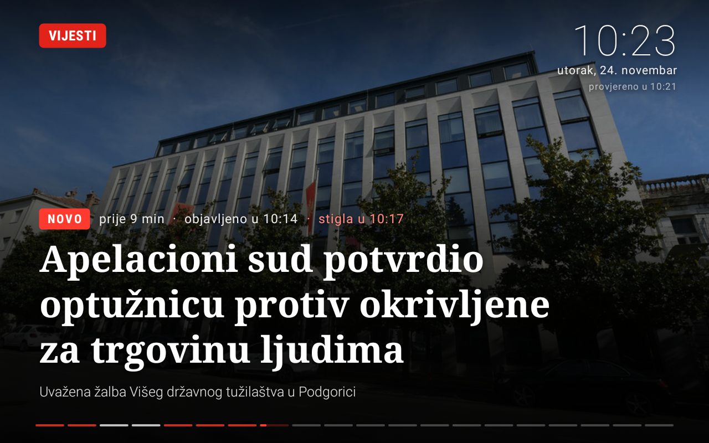

# Vijesti — magazin na stolu

Android aplikacija koja stari tablet pretvara u magazin na stolu. Preko cijelog ekrana se smjenjuje
**20 najnovijih vijesti** sa crnogorskih portala, jedna po ekranu, sa slikom i velikim naslovom.
Kad se pojavi nova vijest, odmah se prikaže i dobije oznaku **NOVO**. Sav tekst je na crnogorskom.



## Šta prikazuje

- **Jedna vijest po ekranu:**
  - slika preko cijelog ekrana koja se polako zumira
  - naslov, kratak uvod, portal i rubrika
- **Vrijeme objave:** „prije 9 min · objavljeno u 10:14"
- **Nove vijesti:** portali se provjeravaju svake 2 minute
  - nova vijest se odmah prikaže, a odozgo sklizne traka „NOVA VIJEST"
  - pola sata nosi crvenu oznaku **NOVO** sa vremenom kad je stigla
- **Bez duplikata:** ista vijest sa više portala je jedna kartica sa napomenom „piše i: Dan · Antena M"
- **Trake na dnu:** pokazuju koja je ovo vijest od 20 i koliko još ostaje na ekranu; nove su crvene
- **Biraš šta te zanima:** Hronika, Sport, Politika, Ekonomija i turizam, Stavovi i kolumne, Kultura,
  Zabava i magazin, Region i svijet, Društvo, Ostalo. Rubrike svakog portala se same svrstaju u ove kategorije
- **Sat i datum** gore desno, uz vrijeme zadnje provjere
- **Prelazi:** slike se pretapaju, a naslov uplovi odozdo
- **Briga o ekranu:** tekst se polako pomjera da se ekran ne „ureže"; noću (23–6 h) se ekran zatamni

## Portali

Vijesti, Dan, Antena M i RTCG, preko njihovih RSS kanala. Za CdM se koristi WordPress API, ali on
sa starijih uređaja često vraća 403 zbog Cloudflare zaštite. Portali se mogu birati u podešavanjima.

## Upotreba

- Pokreće se sama kad se tablet upali (može se isključiti)
- **Dodir po sredini** — otvara članak u ugrađenom čitaču (bez browsera)
- **Povlačenje prstom ulijevo** ili **dodir uz desnu ivicu** — sljedeća vijest; **udesno** ili **uz lijevu ivicu** — prethodna
- **Dugi pritisak** — podešavanja:
  - koji portali
  - koje kategorije vijesti
  - koliko dugo jedna vijest ostaje na ekranu
  - koliko često se provjerava
  - noćno zatamnjenje i pokretanje pri paljenju

## Čitač članaka

Tekst se preuzima sa stranice portala i čisti od reklama, dijeljenja i „pročitajte još" linkova
(jsoup; CdM preko WordPress API-ja). Prikaz: velika fotografija sa naslovom, pa tekst u jednoj
koloni (serif, ~70 slova u redu, krupnije za čitanje sa ~30 cm). **A− / A+** mijenja veličinu slova
(pamti se), **✕** ili „nazad" zatvara i vraća na istu vijest. Dok je čitač otvoren vijesti se ne
smjenjuju; posle 10 min bez dodira čitač se sam zatvori.

## Build

Native Kotlin, bez AndroidX zavisnosti, minSdk 23 (testirano na Androidu 6). Aplikacija sa sobom nosi
korijenske sertifikate (ISRG, GTS), jer ih Android 6 nema, pa HTTPS radi i na starim tabletima.

```
gradlew assembleRelease
```

Potrebna je `local.properties` sa `sdk.dir=...`.
